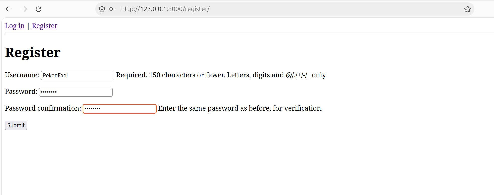
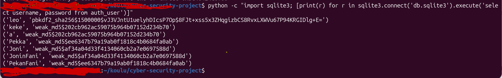

# A02: Cryptographic Failures

### Addition to the Previously Created users, Lets create 2 "fan accounts" with the same exact passwords as their currently existing predecessors:

### And if we now run a command in the terminal to show all of our users and their hashed passwords we get:

### as we can see, the same exact passwords share the same hash