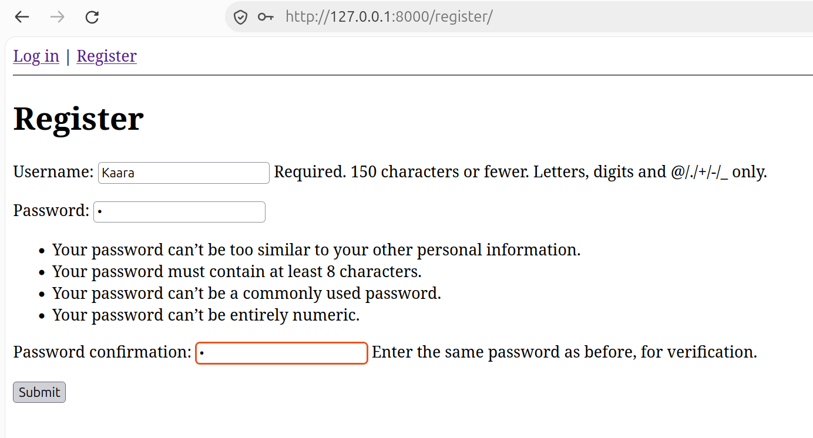
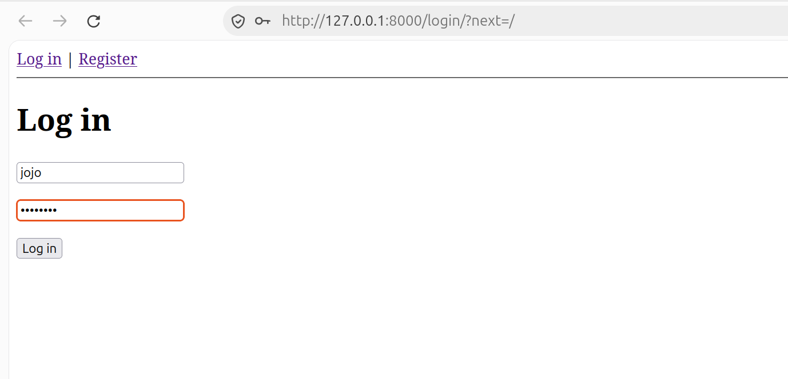
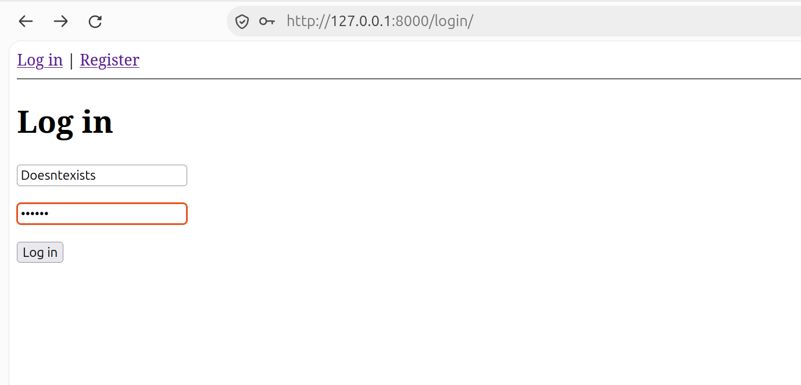
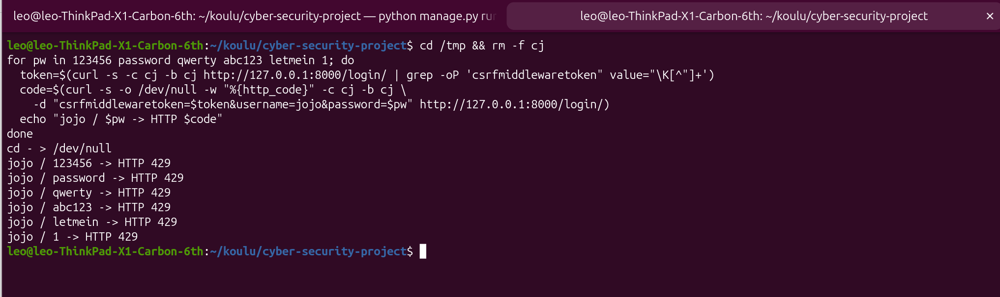

The user is no longer able to create an account with a weak password:

In addition the user is no longer able to get useful feedback from login that could help him with guessing an existing password or an username

Also after adding rate-limiting here, brute-force attacks no longer work the same way:

