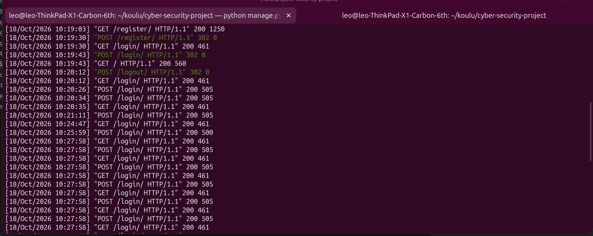

# A09: Security Logging and Monitoring Failures

### The application does not log useful information from login attempts, therefore brute forcing attacks go unnoticed.

In additionto this, there is no place to store the logs:

