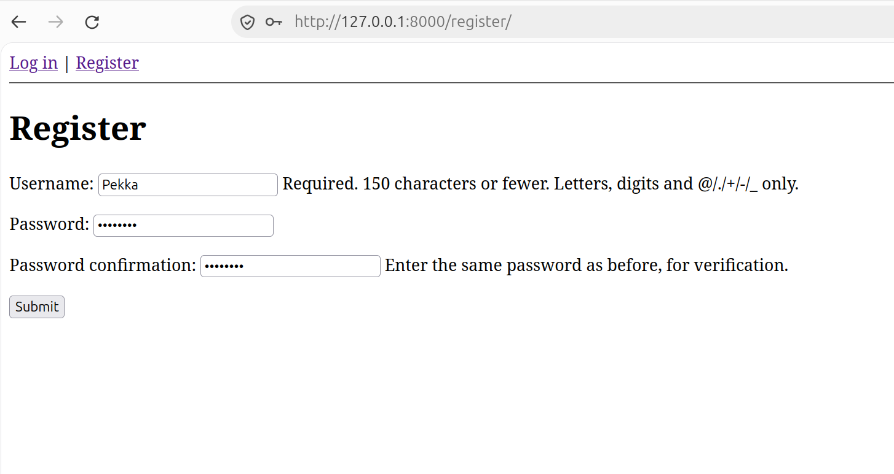

# A01: Broken Access Control

### Register a new user:

### Login with that user:

### Create a new note with that user:

### New note has been created now:

### Lets create another account and make a note with that one too:

### Here comes the Flaw:

### The user is able to see and even delete another users notes just by changing the Note ID value from the URL:

### This applies for all users.

### And after deleting a note:

